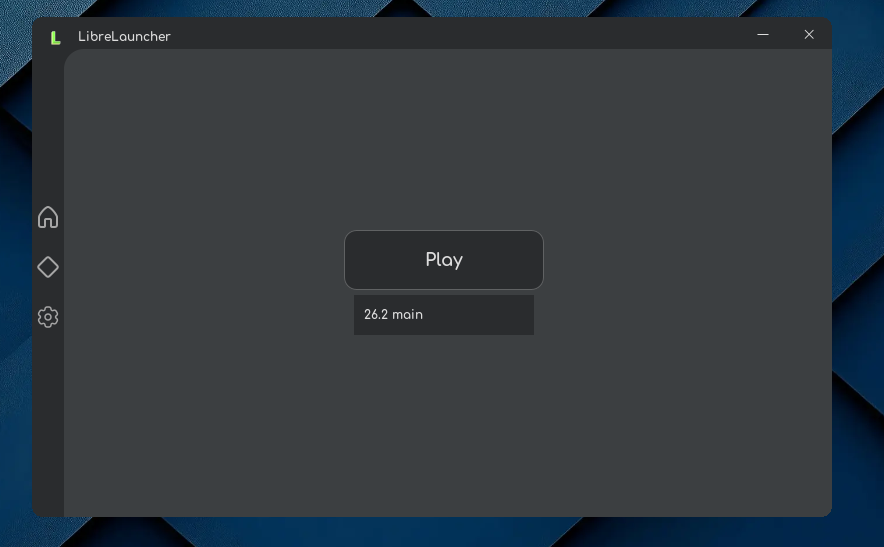

# LibreLauncher
Free and Open-Source Minecraft Launcher

### Features currently present:
* Installation of all Minecraft versions
* Installation of Fabric, Forge, Neoforge and Quilt
* In-app mod/mod pack/resource pack downloading from Modrinth
* Online and offline account support
* Java auto-detection
* Import/export instances

### Features to be added:
* OptiFine support
* World editor(with NBT editing)
* Instance import from other launchers
* Customizable UI
* Browser-based Microsoft log-in
* Smart crash reports
* Safety features for sharing logs
* Share libraries among instances
* Support for musl libc based systems
* Support for BSD-based systems
* Extensive feature documentation
* Plugins/extension support